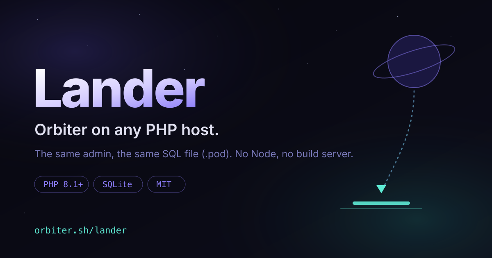
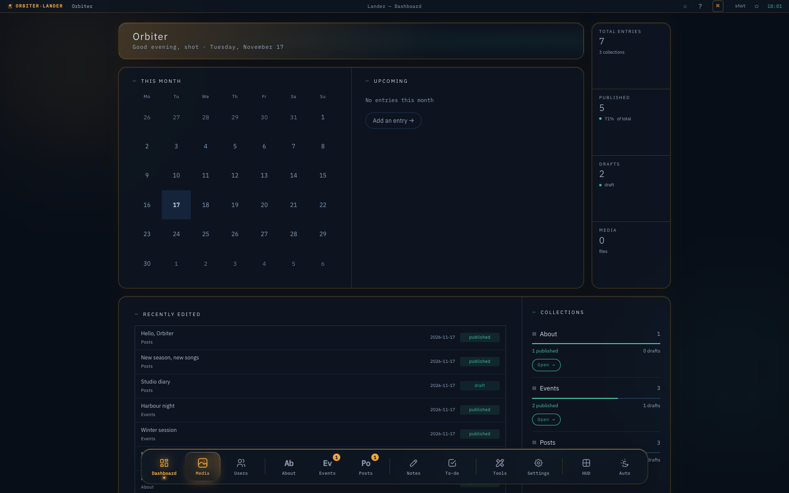

# Lander



<br />

[](LICENSE)
[](https://www.php.net)
[](https://www.sqlite.org)
[](https://github.com/aeon022/orbiter)

> **[Orbiter](https://github.com/aeon022/orbiter) on ordinary PHP hosting.** Orbiter stays in orbit (Node). Lander sets down on any web host with PHP 8.1+ and SQLite: the same admin, the same SQL file (`.pod`), no Node, no build server.

**[orbiter.sh/lander](https://orbiter.sh/lander)** · [Docs](https://orbiter.sh/docs/lander) · [Orbiter](https://github.com/aeon022/orbiter)



---

## Why Lander?

[Orbiter](https://orbiter.sh) is a single-file CMS for Astro that runs on Node. A lot of real-world hosting (shared hosts, cPanel, World4You, Strato, IONOS) offers PHP only. Lander gives editors the **same admin** there, while your site reads the content from a **live API**: edit, save, it is on the site. No rebuild for anything the site fetches at runtime.

The content lives in one SQL file (`content.pod`, a plain SQLite database, only renamed). Copy it between Orbiter and Lander and the site moves with it.

## Features

- **The real Orbiter admin:** Station mode, themes, dock, editor and media library, served as static files and backed by a PHP API with the same paths and JSON shapes.
- **Live read API:** `/api/public/<collection>[/<slug>]` with CORS for your sites and a short cache (10 s by default). Image, file and media fields are resolved to `{ id, url, alt, type }`.
- **Image variants:** `/api/public/media/<id>?w=800&ar=16:9&fmt=webp`, resized, cropped around the focal point and re-encoded (GD), cached on disk. Sizes, ratios and formats snap to fixed sets, so the cache stays bounded.
- **Markdown import:** `.md` with frontmatter through Admin → Import or `bin/lander import-md`.
- **Media as files:** uploads go to `public/media/` (JPG, PNG, WebP, GIF, AVIF, PDF; real file type checked, PHP execution blocked there).
- **Installer:** open `install.php` once. It detects subfolder or domain root, writes the config, creates the first admin and deletes itself.
- **Subfolder or subdomain:** `example.at/lander/` works as well as `redaktion.example.at`.
- **Backup, restore, move:** automatic weekly backups, download as SQL file or ZIP with media, restore with validation, `bin/lander backup` for cron.
- **One-click update:** the admin tells admins when a newer release is out and can install it with one click. Every release ZIP is signed (Ed25519) and checked against the key built into Lander before anything is written. A backup of the pod and the code is saved first (`data/update-rollback/`). Needs the PHP `zip` and `sodium` extensions; otherwise you replace the files by hand.
- **Users:** admins add editors and admins in the admin (Users page): create, change role, reset password, delete.
- **Inbox:** form submissions server-to-server with a token.
- **Hardened:** CSRF origin check, login throttling, escaped output, validated uploads, admin-only meta writes, request size limits. Sessions are HttpOnly, SameSite=Strict cookies.

## Quick start

### On a web host

1. **Upload** the folder to your host, either into a **subfolder** of your site (`example.at/lander/`) or onto a **subdomain** whose document root is `public/`.
2. **Open `install.php`** in the browser (`example.at/lander/install.php`). Pick the admin name and password. The installer checks PHP, detects where it lives, writes `lander.config.php`, creates the pod and adapts the admin paths. Then it deletes itself.
3. **Sign in** at `/login.html` under that location. Done.

In a subfolder, the `.htaccess` in the Lander folder routes everything to `public/`, so `src/`, `data/` (the SQL file) and `lander.config.php` are never reachable from the web. This needs Apache with `mod_rewrite` and `AllowOverride All`, which almost every host has. On Nginx, block everything outside `public/` yourself.

### Locally with Docker

```bash
cp lander.config.example.php lander.config.php
docker compose up -d                       # PHP 8.3 + Apache on http://127.0.0.1:8088
docker compose exec -u www-data lander php bin/lander user <name> admin
docker compose exec -u www-data lander php bin/lander collection blog "Blog"
```

## Connect your website

```js
// Runtime, always current:
const events = await fetch('https://redaktion.example.at/api/public/events').then(r => r.json());

// Build time (SEO, Astro): fetch the same URL in the page frontmatter.
// Responsive image from the media library:
//   https://redaktion.example.at/api/public/media/<id>?w=800&ar=16:9&fmt=webp
```

Add your site's origin to `public_origins` in the config so browsers may read the API.

## Backup, restore, move

- **Automatic:** after an admin signs in, Lander writes `data/backups/auto-<date>.pod` when the newest one is older than `auto_backup_days` (7) and keeps `auto_backup_keep` (8). No cron needed.
- **Cron or by hand:** `php bin/lander backup [--media] [--keep=N]` (`--media` makes a ZIP with the images).
- **In the admin:** Settings → Pod → *Backup & restore*. Restore checks the file (SQLite, integrity, required tables, at least one admin), keeps the current pod as `data/before-restore-*.pod` (last three), unpacks media (images and PDF only, real file type checked) and rewrites media paths for the new host. You are signed out afterwards.
- **Moving:** restore on the new host, or install fresh and restore. Switching between subfolder and subdomain: `php bin/lander rebase /lander` (or `rebase /` for the root).
- Backups contain password hashes: keep them private. Restore is limited by `max_restore_mb` and by PHP's `upload_max_filesize` / `post_max_size`.

## Command line

| Command | What it does |
|---|---|
| `bin/lander user <name> [admin\|editor]` | create a user (password from the prompt or `LANDER_PASSWORD`) |
| `bin/lander passwd <name>` | set a new password |
| `bin/lander collection <id> <label> [singleton]` | create a collection |
| `bin/lander import-md <collection> <folder> [--overwrite]` | import Markdown files with frontmatter |
| `bin/lander import-media <folder> <media-folder>` | add files to the media library |
| `bin/lander backup [--media] [--keep=N]` | write a backup to `data/backups/` |
| `bin/lander rebase [/subfolder]` | adapt the admin paths to a folder |

## Configuration

`lander.config.php` (the installer writes it; `lander.config.example.php` is the template). It lives outside `public/`.

| Key | Meaning |
|---|---|
| `pod` | path of the SQL file (Orbiter format) |
| `data_dir` | rate-limit files, backups, image cache |
| `media_dir`, `media_url` | where uploads are stored, and their public path or full URL |
| `base_path` | `''` for a domain root, `'/lander'` for a subfolder |
| `max_upload_mb`, `max_restore_mb` | upload and restore limits |
| `auto_backup_days`, `auto_backup_keep` | automatic backups (`0` days = off) |
| `public_cache_seconds` | how long browsers and proxies may reuse `/api/public/...` answers (default 10; `0` = no cache): edits go live after at most this long |
| `update_check` | ask GitHub (at most every 12 h) whether a newer release exists, show a hint and the “Update now” button in the admin; `false` = never connect and no update button |
| `form_token` | accepts form submissions (`POST /api/form/{id}`, header `X-Lander-Token`) |
| `public_origins` | sites that may read `/api/public/...` from the browser (CORS) |

## Lander and Orbiter

| | Orbiter | Lander |
|---|---|---|
| Runtime | Node (Hono) | PHP 8.1+ (PDO SQLite) |
| Hosting | VPS, local, desktop app | any PHP shared host |
| Media | in the pod or S3 | files in a folder |
| Passwords | scrypt | PHP `password_hash` (an Orbiter admin needs `bin/lander passwd` after a move) |
| Admin, editor, import, inbox, backup, users (admin/editor) | yes | yes |
| 2FA, reviewer role, per-collection limits, review workflow, webhooks, analytics, form builder | yes | not yet |

Lander is young and in use on a first live site. Expect rough edges and a growing feature list. Issues and pull requests are welcome.

## Part of Orbiter

Lander is the PHP port of the [Orbiter](https://github.com/aeon022/orbiter) admin. The UI comes from Orbiter and the `.pod` schema never diverges, so a pod moves between the two. Docs live at [orbiter.sh/docs](https://orbiter.sh/docs), Lander's page at [orbiter.sh/lander](https://orbiter.sh/lander).

If it saves you time, you can [support the project](https://buy.polar.sh/polar_cl_SFvmYDegcsKDv8O8ZylLlIiXzyNRM7Br9nBx942rj4Q).

## License

MIT. See [LICENSE](LICENSE).
